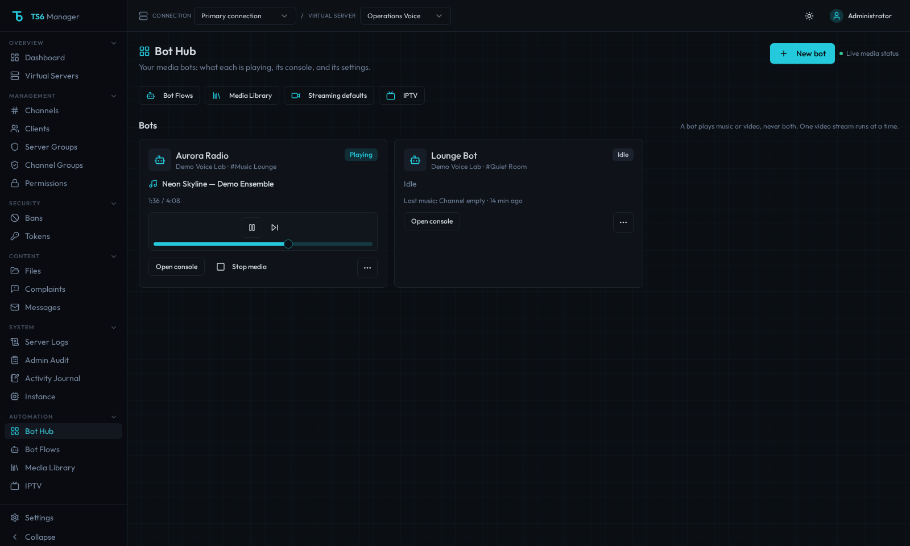
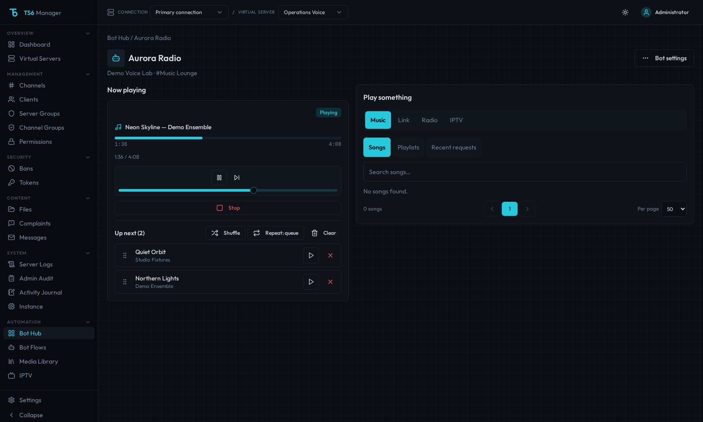

# Media bots

TS6 Manager can run multiple TeamSpeak media bots per server. Each bot has independent playback, queue, and volume state.

## Bot Hub

**Automation → Bot Hub** (`/bot-hub`) is the list of media bots. Each card shows live connection/playback status, current media, channel, progress, volume, and, for video, quality, encoder, viewers, uptime, the no-viewer auto-stop countdown and last stop reason. Live status reads in-memory bot state; it does not probe the media sidecar or TeamSpeak Query.

Use **New bot** to create a bot with a single **Name**, used as both the admin label and TeamSpeak nickname. Names must be 3–30 characters; the web UI and API reject out-of-range nicknames before connecting. If the API request omits `nickname`, it uses `MediaBot`. Each card's settings menu provides **Edit bot**, **Start bot** or **Stop bot**, **Widget link**, and **Delete bot**. The same menu is available as **Bot settings** in the console header. Bots can reconnect automatically with exponential backoff and overlap protection.

A bot plays music **or** video, never both, and only one video stream runs at a time. See [Video streaming — one media session at a time](video-streaming.md#one-media-session-at-a-time). Start/stop failures use the [API error contract](api-errors.md).

## Bot console

Choose **Open console** on a Bot Hub card to open `/bot-hub/:botId`. **Now playing** shows that bot's current media and playback controls. **Up next** holds its music queue; use the drag handles to reorder with a mouse, touch or keyboard, play a queued item now, remove an item, or **Clear** the queue. With a keyboard, focus a drag handle, press Space to pick up, use the arrow keys to move, then press Space to drop or Escape to cancel.

Under **Play something**, choose a source:

- **Music** — Choose **Songs**, **Playlists**, or **Recent requests**; search songs by title or artist. The play button starts an item; the queue button adds it without interrupting playback.
- **Link** — Paste a supported URL and choose **Play as music** or **Stream as video**. For video, a filename can refer to a file already in the music folder; local music files play from **Music**. See [Video streaming](video-streaming.md).
- **Radio** — Search stations or filter by mood, then play a station. Moods come from each station's **Mood or genre** in **Media Library → Radio stations**.
- **IPTV** — Browse groups or search across playlists, filter by **Playlist**, and use **Favourites** or **Recent**. See [IPTV playlists](video-streaming.md#iptv-playlists).

Each **Play something** tab has a **+** link to the matching manage page: **Add songs**, **Add playlist** or **Manage requests** on Music, **Add files** on Link, **Add station** on Radio, and **Add playlist** on IPTV. The link only opens that page.

If the bot is offline, the console offers **Start bot** before showing its sources. When a start conflicts with an active media session, **Replace what is playing?** lists what will stop. Choose **Keep playing** to cancel or **Stop and switch** to replace it.

Radio and video keep the music queue. **Play queue** resumes the upcoming songs, with the replacement prompt when needed; while radio plays and nothing is queued, **Up next** is hidden. While a video streams, **Up next** lists the bot's queued videos and a waiting music queue is shown as one line below it; see [Queue videos and playlists](video-streaming.md#queue-videos-and-playlists). Radio shows the station and live status rather than track progress or skip controls. Music controls include pause/resume, skip and volume; **Up next** also provides **Shuffle** and repeat modes.

## Auto-DJ and 24/7 presence

Open **Bot settings → Auto-DJ & 24/7** on a Bot Hub card or in its console. Existing bots have automation off. Enable Auto-DJ and choose a saved playlist or radio station for that server. Playlist tracks play in saved order, continuing after the last automated track across restarts; a playlist with multiple tracks avoids immediate repeats.

Auto-DJ fills idle time only when neither request queue has upcoming items and no human media is playing or paused. A new music request immediately interrupts automated music or live radio. Automated tracks stay outside the request queue, so request shuffle and repeat controls keep their normal meaning. A kept video queue waits for **Play queue** and blocks Auto-DJ.

**Require a human listener** (off by default) suspends automated playback when the last human leaves, excluding managed media bots and Query clients. It resumes when a listener returns. With this rule off, automated audio continues in an empty channel; ordinary human playback and video retain their existing auto-stop policies.

Manual **Stop** or **Clear queue** starts the saved quiet period (five minutes by default). Requests can still play during that period. Broken sources retry with exponential backoff, starting at 30 seconds and capped at 30 minutes by default. Short radio dropouts count as failures. Quiet periods, retry deadlines and playlist position survive a Manager restart.

**Keep bot in channel (24/7)** reserves the channel from automatic idle-bot summons and restores the most recently joined channel on reconnect. An explicitly targeted `!here <id>` can still move it. Enable **Auto-start** in **Edit bot** to reconnect after a Manager restart. **Stop bot** leaves the server and suppresses auto-start until **Start bot**. **Return home (suspend automation)** reconnects in the configured default channel (or the server's default) and keeps automation suspended. Stop and start the bot to re-enable it. These manual overrides survive restarts.

## Media Library

**Automation → Media Library** (`/media-bots`) manages media shared by every bot on a server. Select the server, then choose one of its five tabs:

| Tab | Purpose |
|-----|---------|
| **Library** | Manage local/downloaded songs and media imports. |
| **Playlists** | Create and edit saved playlists. |
| **Radio stations** | Add stations manually, from built-in presets, or by searching [Community Radio Browser](https://www.radio-browser.info/), then edit name, stream URL and mood or genre. **Play** on each station starts it on a running bot for the selected server. When several bots are running, pick the target under **Play on**. With no running bot, **Play** stays visible but disabled and the hint points to Bot Hub. |
| **Requests** | Review `!play` history and replay or enqueue a request. |
| **Streaming defaults** | Set defaults for future streams and auto-stop chat notices. |

Use a bot's console to choose sources and control playback. Changes to video options in the console apply to that one stream; **Streaming defaults** stay as they are. The console's source lists offer 25, 50 or 100 items per page and remember the chosen size for each list.

Old links still work: `/music-bots` redirects to `/media-bots`; the old **Bots** tab goes to Bot Hub, and **Queue** with a bot ID goes to its console. **Video** with a bot ID goes to the console, otherwise to **Streaming defaults**. **Commands** goes to **Bot Flows → Chat commands**.

## Auto-stop chat notices

**Media Library → Streaming defaults → Announce auto-stops in chat** is enabled by default. When a bot stops music or radio because its channel is empty, it posts a line such as `Stopped the music: the channel was empty for 5 minutes.` or `Stopped radio: the channel was empty for 5 minutes.` Video auto-stops also explain an empty channel or lack of viewers, for example `Stopped the stream: nobody watched for 5 minutes.` The duration follows the configured timeout.

When the video no-viewer timeout is longer than 60 seconds, the bot warns one minute before stopping: `Nobody is watching. The stream stops in 1 minute.` A viewer joining cancels the warning timer and stop countdown. Timeouts of 60 seconds or less skip the warning. All notices use the existing TeamSpeak flood hold.

Turn **Announce auto-stops in chat** off and choose **Save defaults** to suppress both the warning and stop notices. Automatic stopping remains enabled. Video and IPTV use the notice setting saved when the stream starts; music and radio use the current setting when they auto-stop.

## Bot avatars

Open a bot's settings menu in Bot Hub or **Bot settings** in its console, choose **Edit bot**, and use **Avatar → Upload**, **Use default**, or **None**. Uploads accept PNG, JPEG or GIF images up to 200 KB, checked by image content. TeamSpeak 6 clients leave avatars larger than about 320×320 pixels blank, so the bot shrinks larger images to fit 300×300 (keeping the aspect ratio, and keeping GIF animation) before uploading them to TeamSpeak. This uses the `ffmpeg` already shipped in the images. Bot Hub and the console still show the original upload.

New bots created in the web UI use the bundled TS6 Manager app icon by default. Existing bots start with **None**. The chosen image appears on Bot Hub cards and in the console header, even when TeamSpeak refuses the upload. Bot Flows query clients do not use avatars.

The bot uploads and confirms its selected image whenever it connects or the avatar changes. Its TeamSpeak server group must allow file uploads. If TeamSpeak refuses an upload, the bot stays connected and settings show:

> TeamSpeak refused the avatar upload. Allow file uploads for the bot's server group, or choose None.

Choosing **None** clears the avatar and asks TeamSpeak to delete the uploaded file. If TeamSpeak refuses the deletion, the old file remains on the server without being displayed as the bot's avatar.

## Requests

**Bot console → Music → Recent requests** and **Media Library → Requests** (`/media-bots?tab=requests`) show requests for the selected bot, including title, artist and duration when known, source, request time and availability. **Play** starts that request immediately, confirming any media it replaces. **Enqueue** adds it without interrupting playback. When several bots are running, pick the target bot. `/music-requests` redirects here.

History stays in the existing database across restarts. Repeated requests update the same source's time for that bot. By default, the newest 100 unique requests are kept per bot and connection; set `MUSIC_REQUEST_HISTORY_LIMIT` in the backend process environment to a positive integer (maximum 1,000) to change the limit. For Docker, pass it in the backend service's `environment`. Oldest rows are trimmed as requests are saved. Older server-wide history remains visible to bots on that connection and is trimmed when history is read. The timestamp is the request time, including queued items, rather than proof of completed playback. History does not retain requester identities or expose raw URLs or local paths to the UI.

Replay uses the stored media reference through the normal validation and permission checks. Missing files, removed sources, or references rejected by current URL policy show **Unavailable**. Chat `!again` can retry a reference after it becomes available again. A [listener remote](#listener-remote) session cannot open administrator history or replay, but what it adds is recorded in the history.

## Sources

Music bots support:

- radio streams with ICY metadata;
- YouTube playback through yt-dlp;
- Spotify and Apple Music media resolution through the supported resolver path;
- local files and downloaded media; and
- saved playlists.

Local/downloaded tracks are decoded incrementally at media speed to keep memory use bounded on long tracks.

## Playlists

Playlists are shared by every media bot on the same TeamSpeak server. Create and edit them in **Media Library → Playlists**, then start or enqueue them from any bot's **Music → Playlists** view. Chat `!playlist` and `!pl` use the same server-wide list, including playlists created for another bot.

## Channel text commands

When a bot is connected to a configured command channel, users in that channel can use built-in commands.

- **`!help`** — Show built-in and custom commands
- **`!here [id]`** / **`!come [id]`** — Summon an idle music bot to your channel (or target a bot by ID)
- **`!commands`** — List enabled custom chat commands only
- **`!play <url>`** — Play supported media
- **`!play <song name>`** — Search YouTube Music and play the best match (falls back to a regular YouTube search). Queues it if something is already playing
- **`!play`** — Resume paused playback
- **`!history`** — Show this bot's 10 most recent requests, with request IDs, source and UTC time
- **`!again [id]`** — Replay a stored request by ID, or the most recent request when no ID is given. Adds it to the queue while music is playing or paused. Unavailable files or blocked sources report that the media is no longer available
- **`!queue [show|clear|remove <n>|play <n>|<url>]`** — Show or manage the queue
- **`!add <url>`** — Alias for adding to the queue
- **`!playlist [name-or-id]` / `!pl <name-or-id>`** — List or append a saved playlist
- **`!repeat [off|track|queue]`** — Show or set repeat mode
- **`!seek <seconds|+seconds|-seconds>`** — Seek within local/downloaded media
- **`!remove <text>`** — Remove one unambiguous upcoming match
- **`!shuffle [on|off]`** — Toggle or set shuffle
- **`!stop`** — Stop playback and clear the music queue, including a playlist still expanding in the background. **Stop media** on a Bot Hub card does the same.
- **`!pause`** — Toggle pause/resume
- **`!skip` / `!next`** — Advance the queue
- **`!voteskip`** — Vote to skip the current track; more than half of human listeners in the bot channel must vote. Bots do not count, each identity votes once, and changing tracks resets votes
- **`!remote [bot name]`** — Get a private, one-time link to a phone-friendly [listener remote](#listener-remote) for the bot in your channel
- **`!prev`** — Previous track
- **`!vol [0-100]` / `!volume [0-100]`** — Show or set the bot volume. The same level is used for music, radio, video, and IPTV.
- **`!np` / `!nowplaying`** — Show the current track
- **`!radio [id]`** — List or play radio stations
- **`!stream <url> [preset]`** — Start a video stream. Without a preset, a YouTube or Twitch link starts at Auto quality (up to the Auto quality limit) and any other URL at the bot's stored preset (720p by default), because Auto opens the source once more to measure it; `auto`, `480p`, `720p`, `1080p`, `1440p` or `2160p` sets it
- **`!stopstream`** — Stop the active video stream
- **`!viewers`** — List stream viewers
- **`!channels [search]`** — List/search IPTV channels
- **`!tv <name>` / `!iptv <name>`** — Stream an IPTV channel
- **`!lyrics [artist - title]`** — Show/search lyrics

Custom chat commands are configured in **Bot Flows → Chat commands**, alongside the built-in list and clash warnings. See [Bot Flows](bot-flows.md).

Admins can also restrict playback, queue/playlist changes, and video/IPTV commands to selected TeamSpeak server groups there. **Everyone** is the default after upgrading. Help and read-only information stay accessible, including `!history`; human listeners can still use `!voteskip`, and `!remote` is never restricted (what the remote can do follows the same permissions, see below). `!again` counts as a playback command. [Bot flows — Chat commands](bot-flows.md#chat-commands) lists which group each command belongs to. Denied controls receive a short private reply with a cooldown.

### Several bots in one channel

When more than one bot shares a command channel, exactly one of them answers. Name the bot to choose it: `!next Bot 2` when the command takes no other arguments, or `!vol 30 @Bot 2` when it does. The name is the bot's configured name; matching ignores case and extra spaces. An unknown name stays part of the command, so `!playlist Test` still looks up that playlist.

With no name, the bot that is playing, paused or streaming answers. If none is, the lowest bot id answers; if more than one is, the lowest id among those active bots answers. `!help` shows the name syntax.

### Custom command presets

**Bot Flows → Chat commands** can seed recommended server-scoped canned replies shared by every music bot on that connection:

| Command | Purpose |
|---------|---------|
| `!rules` | Server rules text |
| `!links` | Useful links (website, Discord, donate, …) |
| `!discord` | Discord invite (optional; can fold into `!links`) |
| `!info` / `!about` | Short community blurb |

Seeded presets start **disabled**. Edit the placeholder Markdown, then enable. `!commands` is a built-in that lists enabled customs (also shown under Custom in `!help`). Multiple bots on the same channel only send one informational reply (`!help` / `!commands` / customs) per user within a short cooldown.

A `!command` that is not built in, not an enabled custom command and not a Bot Flow command trigger gets a short **Unknown command** reply pointing to `!help` and `!commands`, with a "Did you mean…" hint for near-miss typos such as `!plya`.

## Listener remote

The listener remote lets someone who is listening in the bot's channel see what is playing and add music from their phone, without typing chat commands. It is for listeners, not administrators.

### For listeners

1. Join the channel the bot is in and type `!remote` (or `!remote Bot 2` to pick a bot when several share the channel; see [Several bots in one channel](#several-bots-in-one-channel)).
2. The bot answers in a **private message** with a link: `Your private one-time listener remote link: https://…/remote#token=…`. Open it on your phone or computer. Do not share it.
3. The page shows **Now playing**, **Up next**, a **Library** search box and a **Media URL** box. It refreshes every five seconds while the page is visible.

What you can do on the page:

- see the current track and the queue (the first 50 upcoming tracks, with a count of the rest);
- search the server's song library by title or artist and add a song with the **+** button; and
- paste a link and choose **Request URL** to add it. A link to a playlist adds only its first track.

The queue holds at most 500 items. If the bot is connected and idle, what you add starts playing at once, whether or not Auto-DJ is on. If music is playing or paused, it joins the end of **Up next**. If the bot is streaming video, it joins the music queue and does not start by itself. The remote never interrupts or replaces what is playing. Songs and links added from the remote are recorded in the bot's [request history](#requests).

What you cannot do: pause, skip, stop, seek, change the volume, reorder or clear the queue, or use any admin function. For those, use chat commands (`!skip`, `!voteskip` and so on) or ask an admin.

**Permissions.** Actions follow the same **Who can use this?** settings as chat (**Bot Flows → Chat commands → Built-in command permissions**). Seeing the queue and searching the library are always available to a verified listener. **Add** buttons and the **Media URL** box appear only when you are allowed to use the **Queue and playlist changes** group, just as for `!queue <url>`. If an admin changes that setting while your page is open, the next add attempt is refused with `You are not allowed to use this command.` and the page updates.

**How long it lasts.**

| What | Lifetime |
|------|----------|
| The link | Valid for 5 minutes and works once. Opening it a second time fails. |
| Your session | 15 minutes from the moment you open the link, no matter how much you use it. Activity does not extend it. |

When the session ends, the page says the access is invalid or expired. Type `!remote` in the channel again to get a new link. The page keeps the session only in the browser's memory, so reloading or closing it also means asking for a new link.

**What ends a session early:**

- you leave the bot's channel or are moved out of it;
- the bot moves to another channel or disconnects;
- an administrator revokes access;
- you type `!remote` again (the new link replaces the earlier link and session for that bot); and
- the Manager backend restarts.

**Rate limits** are per minute and keep the page usable for everyone: you can request about three links per minute for a bot, paste at most five links per minute in one session, and only one pasted link per bot is resolved at a time. The page shows `Too many remote requests` or `A media request is already pending.` when you hit a limit; wait a minute and try again.

**What you may see in chat** when asking for a link. All of these arrive as private messages:

| Reply | Meaning |
|-------|---------|
| `Listener remote needs a verified listener in the bot channel.` | You are not in the bot's channel, the bot is not connected, or TeamSpeak could not confirm who you are. Join the channel and try again. |
| `Listener remote is unavailable: an admin must configure Public URL.` | No Public URL is set. Tell an admin. |
| `Listener remote requires an HTTPS Public URL.` | The Public URL is not HTTPS. Tell an admin. |
| `Listener remote is unavailable right now. Try again shortly.` | A temporary error, or you asked for links too often. Wait a moment. |

Asking again within a couple of seconds is ignored, and nothing is sent while the bot is holding back chat because of TeamSpeak flood protection.

### For administrators

- **Set an HTTPS Public URL.** The link starts with the manager's Public URL. Setting the `PUBLIC_URL` environment variable is the simplest way. The same address can be saved in the UI: there is no Settings page for it, only the **Public URL of this manager** field under the hosted banner upload in a channel's edit dialog (it appears once a banner has been uploaded, or through **Change** when one is set). A saved value wins over the variable. It must be reachable from listeners' phones. A plain `http://localhost` address is accepted only outside production, for development. Links are never built from the request's `Host` header.
- **Put it behind a reverse proxy and set `TRUST_PROXY`.** The remote's rate limits are per client address, so the backend must see real client addresses. Without `TRUST_PROXY`, every listener appears to come from the proxy and shares one limit. See [Reverse proxy — Listener remote and client IP limits](reverse-proxy.md#listener-remote-and-client-ip-limits) for the recommended values and for what to turn off in proxy logs.
- **Run one backend.** Links, sessions and limits live in memory; a restart ends every session.
- **Revoke access.** An administrator can end all remote sessions for a bot, or one listener's, with `POST /api/listener-remote-admin/bots/<bot id>/revoke` using the normal admin sign-in. Pass `{"uid": "<TeamSpeak unique ID>"}` to revoke one person and omit it to revoke everyone; the response is `{"revoked": <count>}`. There is no button for this in the web UI yet.
- **Audit.** Issuing a link, adding a song or link, and revoking are recorded in the audit history with an anonymous fingerprint for listeners, never the link, session or pasted URL.

The remote cannot reach any other part of the manager: its session does not authenticate administrator pages or APIs.

## Download progress

Explicit library downloads run as bounded background jobs and can expose:

- current and total item counts;
- yt-dlp percentage;
- speed;
- ETA;
- processing state; and
- failure status.

Progress endpoints require an authenticated administrator, the matching server, and the requesting user. Jobs are kept in memory, capped, and expire automatically. A backend restart clears progress history.

## yt-dlp lifecycle

Production containers do not self-update yt-dlp.

The tool is installed at image build time and validated alongside FFmpeg, Node, and Deno. Deno (pinned in `.deno-version`) is the only yt-dlp JavaScript runtime configured for YouTube challenge solving (`--js-runtimes deno`). Image Node remains 20 for the Nest backend and is not an EJS fallback. To update the bundled extractor or Deno, pull a newer TS6 Manager image and recreate the container, or rebuild from a fresh image build.

Administrators can confirm the currently bundled yt-dlp (and related media tools) with the demand-driven Runtime / media check on Settings → YouTube or Media Library → Library. That check is not part of live bot status polling. For a fuller report (tool versions and paths, a short test decode and encode, yt-dlp extractors, Deno and sidecar health), administrators can open **System → Diagnostics**; it runs when the page opens and again only on **Refresh**. See [Video streaming — Troubleshooting](video-streaming.md).

A public-video smoke test is intentionally not a release gate because media availability, rate limits, and regional restrictions are external to the project.
